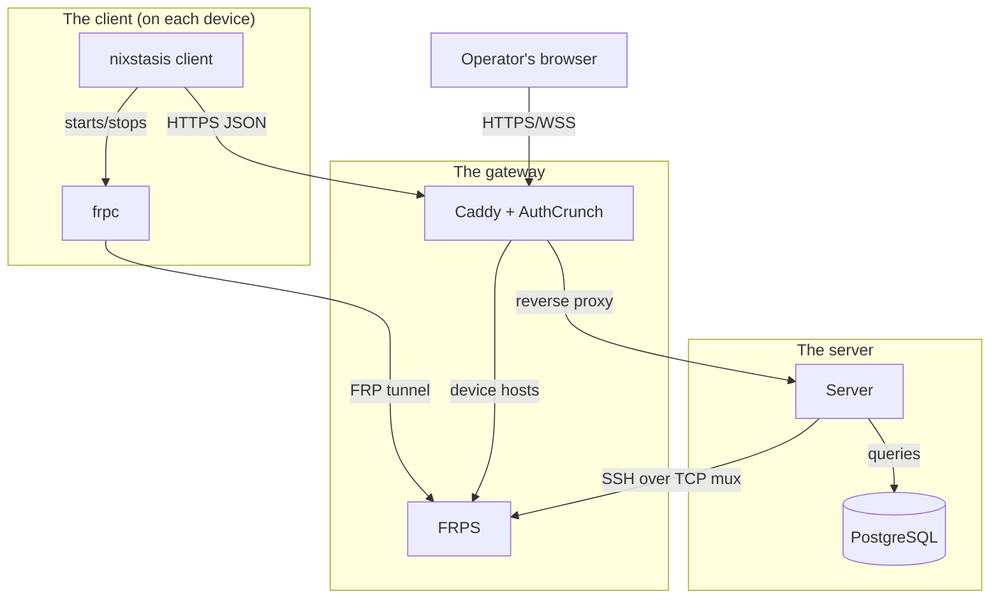

# Architecture Overview

Nixstasis has three parts: the client on each managed device, the server, and a gateway of Caddy and FRPS in front of
the server. Devices always connect outward, so no inbound ports are opened on them.

The server is written in Elixir with the Phoenix framework, so its pages and diagrams often call it Phoenix. The client
is written in Go.

## Components

- **Server:** the `:nixstasis` OTP application ([Server Application](modules/server-application.md)) serves the
  web UI, the device API, the E2E API, and a generated Ash JSON:API. The Ash domain
  ([Server Domain](modules/server-domain.md)) holds devices, groups, commands, command policies, scripts, alerts,
  telemetry, reports, and settings in PostgreSQL.
- **Client:** the `nixstasis` binary ([Client CLI](modules/client-cli.md)) registers the device, sends a
  heartbeat with script-produced telemetry, runs server commands, and starts `frpc` when remote access is granted.
- **Gateway:** Caddy terminates HTTPS, issues device certificates on demand, and authenticates operators with AuthCrunch
  ([Gateway Caddy](modules/gateway-caddy.md)). FRPS carries device tunnels ([Gateway FRP](modules/gateway-frp.md)).
- **Deployment:** one Compose file runs `nixstasis`, `caddy`, `frps`, and `postgres`, plus a development device
  simulator ([Deployment](operations/deployment.md)).

## How requests flow

- **Operators** reach Phoenix through Caddy, which authenticates them and forwards verified role claims. LiveViews run
  over a WebSocket; browser terminals use a Phoenix Channel, and Phoenix opens SSH to the device through the FRPS TCP
  mux.
- **Devices** call `/api/v1/devices/...` through Caddy. Each heartbeat delivers telemetry and receives queued
  commands, and the device posts command results back. The full sequences are in [Data Flow](data-flow.md).
- **Remote access** is pull-based: when an operator opens a session, the next heartbeat carries a signed, lease-bound
  credential, the device starts `frpc`, and FRPS asks Phoenix to authorize the tunnel. Lease rules are owned by
  [Server Devices](modules/server-devices.md).
- **Certificates** for device hosts are issued only after Caddy asks Phoenix `GET /api/v1/check_domain`.

## API surfaces

| Surface                | Consumer                       | Authentication                                        |
|------------------------|--------------------------------|-------------------------------------------------------|
| LiveView and Channels  | Operators                      | AuthCrunch at Caddy, then Phoenix role checks.        |
| `/api/v1/devices/...`  | The client                     | The device runtime token; registration issues it.     |
| `/api/json`            | Operator and developer tooling | AuthCrunch, then route and data-layer policies.       |
| `/e2e`                 | The E2E harness                | A dedicated runner ID and token; disabled by default. |
| `/api/v1/check_domain` | Caddy                          | Internal to the Compose network.                      |

Contracts for each surface are in [API & Runtime Contracts](reference/contracts.md); trust boundaries are in
[Runtime Boundaries](runtime-boundaries.md).

## Design decisions

- **Failures stay contained.** Each piece of server state that lives in memory, such as leases, terminal keys, rate
  limits, and offline checks, runs in its own supervised process. If one crashes, only that one restarts.
- **Business rules live in contexts.** LiveViews and controllers call context modules such as `Nixstasis.Devices` and
  `Nixstasis.Scripts`, which check permissions and handle side effects. Ash resources hold the data, actions, and
  policies underneath.
- **Telemetry is flexible.** Telemetry and product schemas are stored as JSON, so device scripts can change what they
  report without a database migration. The report and alert builders read the schemas each device advertises.
- **The device has the final say on what runs.** The server writes and schedules Stary scripts and command policies,
  but the client parses them, provides the builtins, and enforces the limits and the allowed commands
  ([Client Starlark Runtime](modules/client-starlark-runtime.md)).
- **The device decides what is exposed.** The server only names a remote-access profile; what that profile forwards is
  defined on the device ([Client FRP Manager](modules/client-frp-manager.md)).
- **Phoenix decides which devices an operator can reach.** The identity provider supplies roles, but device scope is
  decided only by Phoenix.
