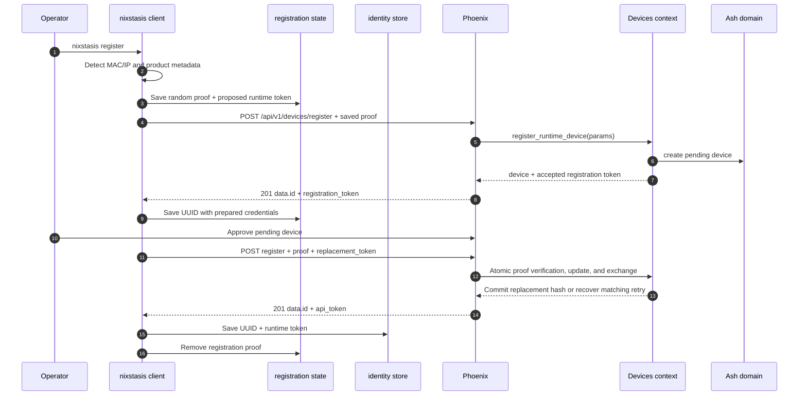
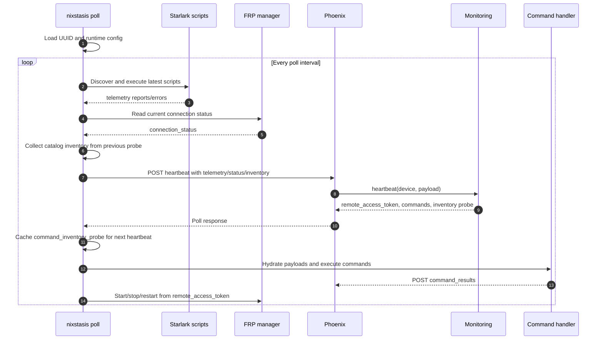
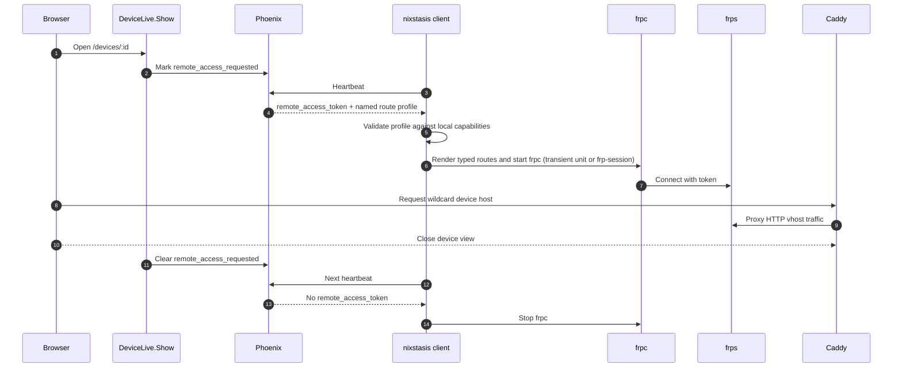
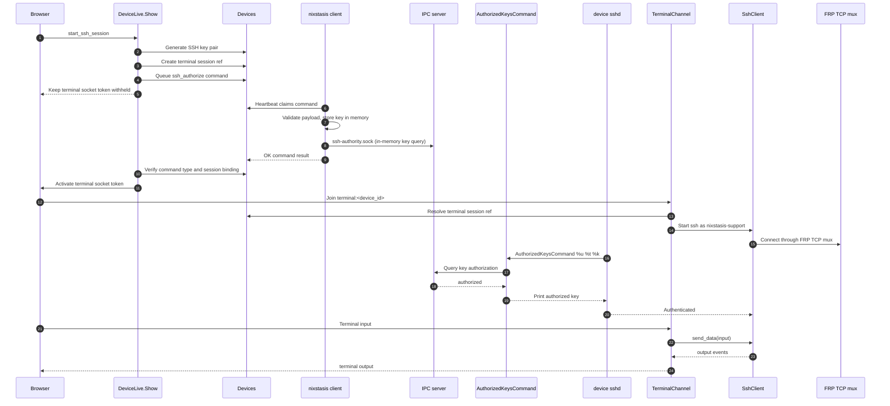
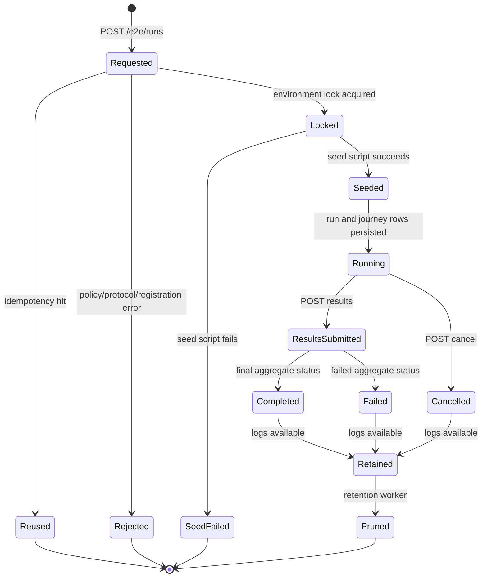

# Data Flow

How data moves between devices, the server, and operators for each of the main jobs Nixstasis does. Each section
pairs a sequence diagram with the steps in plain language.

## Device Registration

Registration happens in two rounds: the device asks to join, an operator approves it, and the device then swaps its
one-time proof for a long-lived token.

1. An operator or service runs `nixstasis register`. The client works out its MAC, from the configured identity
   interface or the one that routes to the server ([Client Identity](modules/client-identity.md)), and its IP
   address.
2. Before contacting the server, the client generates two secrets, a `registration_token` (the proof) and a separate
   `replacement_token`, and saves them to `config.RegistrationPath()`, readable only by its owner. Because they are
   saved first, a lost response or a restart reuses the same secrets instead of starting over. If this recovery file
   exists, it wins over any existing identity file.
3. The client sends both secrets with its MAC address, product and schema data, and any optional metadata.
4. The server creates a pending device and stores only a hash of the proof. If two requests race with different
   proofs, the first one wins and the other cannot overwrite it.
5. A MAC address that is already enrolled can register again only with its matching proof or its current runtime
   token; anything else is refused before the record changes. Registration only ever updates device-owned details. It
   never touches approval or remote-access settings, which belong to operators.
6. An operator approves the device. The proof still cannot be used for heartbeats or other runtime calls.
7. On its next attempt, the client trades the proof for its `replacement_token`, which becomes the runtime token. The
   old proof stops working. If the response is lost and the client retries with the same replacement, it gets the same
   token back; a retry with a different replacement is refused.
8. The client saves its UUID and runtime token to `config.IdentityPath()` and deletes the registration file. If saving
   the identity fails, the credentials stay in the recovery file, so an old identity can never take their place.

## Polling and Telemetry

`nixstasis poll` is the device's main loop. It loads the device UUID from `/etc/nixstasis/id`, sets up its HTTP
client, script runner, FRP manager, and command handler, and runs one poll straight away and then on every tick.

Each poll:

1. Re-detects the IP address. The MAC is the one saved at registration.
2. Runs the latest version of each script in the script directory and collects their reports and errors.
3. Reads the current FRP tunnel status.
4. If the server asked for it on the previous heartbeat, gathers a small inventory of installed packages and commands.
5. Sends `POST /api/v1/devices/:uuid/heartbeat` with `Authorization: Bearer <device-token>`. The body carries
   telemetry, tunnel status, the device's sshd public host key, and the optional `command_inventory`.

On the server, `HeartbeatController.create/2` rejects devices that are not approved. `Nixstasis.Monitoring.heartbeat/2`
then:

- updates `last_seen_at`;
- checks the SSH host key against the one on record, or records it the first time. A changed key is held for review
  and blocks browser terminals until an operator trusts it;
- saves the telemetry and inventory, and evaluates alert rules;
- picks up any queued commands.

The response can carry a `remote_access_token`, a list of commands, and a `command_inventory_probe` saying which
packages and commands to report next time. The client keeps the probe for the next heartbeat, runs the commands and
posts their results, and starts, stops, or restarts `frpc` to match the token. Reported inventory is only evidence; it
never authorizes a command on the device.

## Command Policy Catalog Resolution

Catalog-backed command policies let operators pick commands by package name instead of by path. The server works out
the real paths from what each device reports:

1. Each heartbeat response includes a `command_inventory_probe` built from the active catalog mappings.
2. Up-to-date clients look up only the packages and commands named in the probe and report them on a later heartbeat.
3. The server keeps the latest report for each device, separate from telemetry, and ignores anything it did not ask
   about.
4. When an operator assigns a policy, the server combines the approved catalog mappings with each device's report to
   find absolute command paths.
5. The device then receives the same versioned `apply_command_policy` command as any other policy, with absolute paths.
6. Assignment is blocked if a package is missing, the OS family is unsupported, the report is stale, or paths
   conflict. Assigning a policy never installs packages.
7. The device enforces only the absolute paths it was sent. Catalog IDs and package names carry no authority on the
   device.

## Command Delivery and Results

1. Server code queues a command with `Nixstasis.Devices.queue_command/2`.
2. On the next heartbeat, `Nixstasis.Devices.pop_pending_commands/1` claims queued commands in a transaction and the
   response delivers them to the client as `PollResponse.Commands`.
3. If a command's payload was too large to inline, the client fetches it with
   `GET /api/v1/devices/:uuid/command_payloads/:ref`.
4. The client's command handler runs the command; the supported commands are listed in
   [Client Command Handler](modules/client-command-handler.md).
5. The client posts results to `POST /api/v1/devices/:uuid/command_results` with `Authorization: Bearer <device-token>`,
   and `DeviceCommandController.command_results/2` records them with `Devices.acknowledge_command_results/2`.

What can go wrong:

- A command with a missing or duplicate ID, or of an unsupported type, is reported back as failed by the client.
- A results request without a `results` list gets HTTP `400`.

## Remote Access Through FRP

Remote access is pull-based: the server never connects to a device. It hands the device a credential on its next
heartbeat, and the device opens the tunnel itself.

1. An operator opens `/devices/:id`. If the device is online, `DeviceLive.Show` opens a time-limited remote-access
   lease for that page.
2. While the lease is active, each heartbeat carries a signed `remote_access_token` that expires with it, along with
   `remote_access_expires_at_ms`, `remote_access_lease_id`, and optionally a named, versioned `remote_access_profile`.
3. The client looks up the named profile in its own local definitions. A missing, unknown, or invalid profile is
   refused and reported in `connection_status.error`.
4. The client starts `frpc` with only the validated local routes from that profile, using the token from the
   heartbeat. `frpc` connects to FRPS, and FRPS accepts it only for the lease that is currently selected.
5. Caddy routes the wildcard host `*.{$BASE_DOMAIN}` to FRPS, which forwards the traffic down the tunnel.
6. When the operator leaves the page, its lease closes. The next heartbeat brings a new credential if another lease is
   still open, or no token at all, and the client stops `frpc`.

When several leases overlap, which one wins, and how leases survive a server restart, are covered in
[Server Devices](modules/server-devices.md).

## Browser Terminal Session

A browser terminal uses a fresh SSH key for every session. The device keeps the public key in memory only, and the
browser cannot connect until the device confirms it has the key.

1. The operator starts a terminal from the device page. The server generates a key pair with
   `SshKeyManager.generate_key_pair/0` and creates a session reference first, so the session exists before anything
   is sent to the device.
2. The server queues an `ssh_authorize` command with the public key, the `nixstasis-support` user, a time limit, and
   the session reference.
3. The device picks the command up on its next heartbeat, checks the payload, and keeps the key in memory. It answers
   key lookups on the local socket `/run/nixstasis/ssh-authority.sock`.
4. Once the device reports success, the server lets the browser open its terminal socket. The browser joins
   `terminal:<device_id>` with the session reference.
5. `TerminalChannel.join/3` checks the reference belongs to this device and starts `Nixstasis.Devices.SshClient` as
   `nixstasis-support`. The SSH client writes the private key and the pinned host key into a private temporary
   directory (mode `0700`, files `0600`) and connects with `ssh` through an `ncat` HTTP proxy to the FRP TCP mux.
6. On the device, sshd runs its `AuthorizedKeysCommand` with `%u %t %k`. The helper asks the client over the socket
   and prints the key only on an exact match.
7. Keystrokes go to `SshClient.send_data/2`, and output comes back to the browser as channel `output` events.
8. The session ends when SSH exits, sits idle too long, or hits its maximum length. The server deletes its key
   material first, then queues an `ssh_revoke` command
   (`application/vnd.nixstasis.ssh-revoke+json;version=1`, with matching `name` and `data.session_ref`) that is safe
   to repeat. The same cleanup runs when the device goes offline, the lease expires, queueing fails, or the join
   fails. A join with an unknown reference has nothing to clean up, so it sends no revoke.

The command payloads are specified in
[API & Runtime Contracts](reference/contracts.md#browser-terminal-ssh-authorization-contract).

## LiveView Event Cycle

The operator UI is built from Phoenix LiveViews:

1. A browser request goes through Phoenix's `:browser` pipeline to a LiveView.
2. `mount/3` sets up the page state, and `handle_params/3` loads data for the current URL.
3. User actions call `handle_event/3`, which updates the page state, flash messages, or navigation.
4. LiveView sends only the changes back to the browser over its WebSocket.

The main pages handle these events:

- **Devices:** search, filter, sort, select, and approve or reject in bulk.
- **Device detail:** switch tabs, retry a session, and start an SSH terminal.
- **Alerts:** validate and save rules, confirm discarding changes, delete rules, sort, and filter.
- **Reports:** sort, filter, confirm deletion, and filter report details.
- **Device groups:** create, rename, archive, restore, and change memberships.
- **Scripts:** edit drafts, validate, choose targets, queue tests and deployments, retry, and cancel.
- **Command policies:** edit entries and categories, preview, and assign to devices.
- **Settings** (admins only): save monitoring and notification settings.

## E2E Run Lifecycle

1. The client E2E runner loads its config and journey specs, then sends `POST /e2e/runs` with its runner ID, bearer
   token, and `X-E2E-Protocol-Version`.
2. The server checks the request: the environment policy, the protocol version, the suites and journeys selected, and
   that every action and expectation is registered.
3. The run is tied to the runner that created it. Repeating a request with the same runner, environment, and
   idempotency key returns the existing run instead of starting another.
4. For a new run, the server locks the environment, runs the seed script, and saves the run with a queued result for
   each journey.
5. The client runs the journeys and writes JSONL logs, then submits results to `POST /e2e/runs/:id/results`.
6. The server records the results, works out the overall status, and releases the lock once the run is finished.
7. Logs are available from `GET /e2e/runs/:id/results/:journey_id/log` until the retention worker prunes them.

Only the runner that owns a run can submit its results or read its logs; any other runner gets `404`.

What can go wrong:

- `409 environment_locked`: another run is already active in that environment.
- `422 protocol_mismatch`: the protocol version is wrong.
- `400 invalid_action_expectation`: an action and expectation pair is not registered.
- `422 seed_failed`: the seed script failed.
- `410 log_unavailable`: the log is missing or has been pruned.
