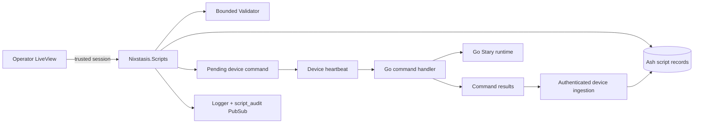

# Server Scripts

`Nixstasis.Scripts` is the server side of the Stary script workbench. It stores drafts and the fixed versions made from
them, runs quick checks on them, confirms the operator may target each chosen device, queues test runs and
deployments, records each device's result, and publishes audit events. The client is still the final word on how a
script actually runs.

## Owns

`Nixstasis.Scripts` in `packages/server/lib/nixstasis/scripts.ex`, with `Authorization`, `Validator`, and `Audit` under
`packages/server/lib/nixstasis/scripts/`, and these Ash resources:

- `ScriptDraft` stores editable name, front matter, body, and draft status.
- `ScriptVersion` stores the version, source fields, status, and the final rendered script in `rendered_content`.
- `ScriptValidationRun` stores pass/fail preflight results and the rendered artifact used.
- `ScriptTestRun` stores a selected target list, command payload, and aggregate test state.
- `ScriptDeploymentRun` stores a selected target list, install payload, and deployment state.
- `ScriptClientAction` tracks one device's part of a run: queued, delivered, acknowledged, failed, and its result.

The `/scripts` LiveViews read and write these records only through the context; there are no JSON:API routes for them.

## Entry points

The context offers workbench actions rather than raw create, update, and delete:

- `list_drafts/0`
- `create_draft/2` and `update_draft/3`
- `render_draft/1` and `validate_draft/2`
- `queue_test_run/4` and `queue_deployment/4`
- `ingest_command_results/2`
- `ingest_test_results/3` and `ingest_deployment_results/3`
- `retry_test_devices/2` and `retry_deployment_devices/2`
- `cancel_test_run/2` and `cancel_deployment_run/2`
- `archive_draft/2`

A test run sends `run_script`, which runs the script once without installing it. A deployment sends `install_script`
with the fixed version. Either one accepts at most 250 devices, and reloads the chosen devices from the database,
within the operator's scope, before it creates anything.

The device picker searches and sorts in the database, within the operator's scope, and shows at most 50 devices at a
time. Devices already chosen stay chosen when the search changes, and a 251st device is refused. When the run is
queued, every chosen device is reloaded, not just those on the current search page.

## Boundaries

### Authorization

`Nixstasis.Scripts.Authorization` takes the operator's permissions from `NixstasisWeb.Permissions`. Before a test or
deployment is created, every chosen device is checked against the device scope in the operator's session. If the list
is empty, or any device is out of scope, nothing is saved or queued. Retries go through the same checks. Before loading
an old run's device list, a retry first checks how many devices it has; an old run over the limit can still be viewed,
but retrying it fails without changing anything.

Operator audit events need the operator's ID, taken from the session's subject or email. Results from devices are
attributed to the device that `DeviceCommandController` authenticated, under a separate event type.

### Validation and artifact ownership

`Nixstasis.Scripts.Validator` renders a draft and checks its front matter, schema, body layout, and basic Starlark
structure. It catches common mistakes early, but it is deliberately not a full Starlark parser. Validation, tests, and
deployments all use the same `ScriptVersion.rendered_content`; editing the draft afterwards does not change a version
that is already queued.

Everything else is decided on the device, by the client's `internal/script` package: full parsing, schema
compilation, builtins, timeouts, output checks, runtime errors, which commands `exec_cmd` may run, the device's own
per-path `exec_command_args` policy, and the per-path policy for `read_file`. A command policy sent from the server
cannot widen argument permissions or `runtime.read_files`.

### Command delivery and results

Commands are queued through `Nixstasis.Devices` and delivered with heartbeats like any other command. Scripts up to
4,096 bytes travel inside the command. A larger `run_script` payload is stored on the server, and the client fetches it
from the authenticated `/api/v1` payload endpoint before running it. If the payload is missing, that device's action
fails and nothing partial runs.

`DeviceCommandController` authenticates each device before passing its results to
`Nixstasis.Scripts.ingest_command_results/2`. That stamps each result with the device's ID, updates its action, works
out the overall run status, and tells the LiveView to refresh, without sending any result data in the notification.

### Audit

`Nixstasis.Scripts.Audit` adds `action`, `actor_id`, `actor_type`, and a UTC `timestamp` to each event, logs it with
`Logger`, and broadcasts `{:script_audit, payload}` on the `script_audit` PubSub topic. There is no audit table, so how
long events are kept, and how they are exported, depends on your log collection.

Operator workflows are in [Stary Script Workbench](../operations/script-workbench.md); the client side is in
[Client Command Handler](client-command-handler.md) and [Client Starlark Runtime](client-starlark-runtime.md).
